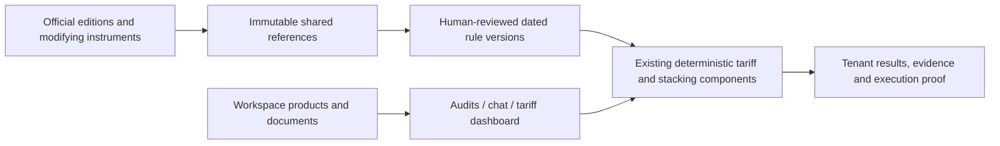

# Supabase architecture and historical-data audit — October 22, 2026

This records the **linked database and the current dev working tree**, not a
production-website release or a certification of legal accuracy. The existing
website has not been redeployed. No schedules, delivery, reviewer appointments or
legal approvals were activated.

## Result

The historical data was present in several different forms, but was not a complete
historical rules corpus. Current search rows, extracted Section 232 rows, reviewed
stacking instructions and tenant source captures serve different purposes. They
now connect to one immutable shared reference archive and the existing Audits
workflow. Captures remain evidence; only approved scoped legal definitions can
establish a full expected duty.

Five incremental migrations were applied and recorded:

1. `20261022173053_supabase_access_and_query_structure.sql`: 65 foreign-key indexes;
   split 19 overlapping ALL policies into insert/update/delete policies; removed
   two exact duplicate read policies; cached seven auth/reviewer policy expressions;
   corrected two typed SQL initializers; removed legacy member-callable Section 232
   mutation surfaces while preserving service-only operations.
2. `20261022173055_versioned_tariff_references.sql`: shared original sources,
   publication directory, exact-code rate projections, authenticated readers and
   pinned audit reference selections.
3. `20261022175243_historical_release_identifiers.sql`: preserve the publisher's
   older historical identifiers instead of rejecting or renaming them.
4. `20261022180033_resumable_tariff_reference_chapters.sql`: atomic per-chapter
   publication, immutable completion/hash markers and safe retries after timeouts.
5. `20261022181441_scoped_historical_rule_selection.sql`: indexed selection by
   exact HTS, origin and entry date, avoiding a global 100-rule bottleneck.

No tenant catalogue was rewritten, old table dropped, original overwritten or
current rate substituted into a historical shipment. Isolated fictional QA
workspaces retain their own test audit history; their sessions were revoked and
identities banned after verification.

## Verified data and its limits

- 173 full-edition publication/availability records, preserved from the official
  USITC release registry. This is a directory, not 173 downloaded schedules.
- Four completely projected original editions: `2023HTSARev4a` (22,744 rate leaves),
  `2024HTSRev1` (22,919), `2024HTSRev2` (22,919), `2026HTSRev21` (22,957): **91,539**
  versioned rate records. Every edition accounts for all 99 chapters, including
  reserved 77, and matches its expected count.
- Four revision-verified Chapter 99 subchapter III originals and seven linked
  Federal Register modifying documents. Original and compressed hashes are checked.
- Existing current HTS, Section 232 and stacking data retained as three explicitly
  labelled legacy observations, with no reviewer identities in shared captures.
- The current search index previously had 22,958 current-revision records; that is
  not equivalent to the 22,957 leaves in the downloaded original edition. Neither
  store overwrites the other or silently fills a historical gap.
- The existing 1,593 auto-approved Section 232 extractions have **zero** consolidated
  coverage reviews. Their dates and rates are candidate evidence, not new approval.
- One previously stored human stacking instruction is reusable under its original
  target, date, condition and conflict checks. Two other drafts remain pending.
- Tenant monitoring archives were not promoted into global legal authority.
- There are still **zero approved historical audit bundles and zero appointed
  platform reviewers**. Consequently full real-law audit totals remain unresolved.
  A reviewer can now prepare drafts from retained originals instead of retyping
  published rates. Effective scope, exclusions and origin evidence still need review.

The chosen editions cover dates in the available fictional import fixtures, plus
the current edition. No complete real customer ledger or independently reviewed
broker calculation was supplied. These captures do not establish all historical
exclusions, retroactive legal changes, AD/CVD or sector-specific Section 232 coverage.

## Boundaries and routing

- Browser/page requests use publishable-key clients, authenticated workspace identity
  and RLS. Workspace selection has a deterministic order in middleware, server and
  worker adapters. Tenant/customer IDs in request JSON never establish membership.
- The server client rejects its legacy outside-request service-client fallback on
  Vercel. Existing local CLI compatibility remains; worker sessions use a separate
  explicit adapter. No privileged website key was added to enable a calculation; the configured Vercel website environment contains neither database service-key name.
- Three internal worker endpoints isolate privileged execution: audit, live check
  and the older aggregate recalculation bridge. Their signature/shared-secret and
  hosted-role guards remain. Background/CLI service clients are not normal browser
  data clients. Existing test-support imports were excluded from the production map.
- Expensive reference lookup/download routes use the existing shared DB admission
  quota. Draft creation stays behind explicit platform-reviewer authorization.
- Global official references have authenticated read-only policies. Tenant originals,
  inputs, review events and results retain tenant membership policies. The catalogue
  view is `security_invoker`; evidence, rates and publication markers are immutable.
- Source IDs and rule IDs are pinned for reproducibility; release selection uses the
  retained registry snapshot. Capture/publication/availability dates never become
  legal effective dates. Historical source IDs augment, rather than replace, the
  existing tenant check archive or current HTS search index.
- Audit exports and detail reads require protected completed worker proofs and
  verify the saved data/hash chain. v1 proofs remain readable with their original
  version; new execution uses v2. A source hash by itself is not an execution proof.
- Original files are private database chunks. There are no configured Storage
  buckets and no parallel public-bucket upload path. This preserves existing intake.
- Existing legacy workflows remain intact. They are documented as such, rather than
  forcing unrelated tables into the new Audits path or deleting them.

## Inventory and code map

The metadata snapshot covers 78 public/private/storage relations, 815 columns,
328 constraints, 213 indexes, 151 policies, 51 public/private functions, 33 triggers
and 50 applied migrations. The application map scans 327 non-test source files,
including API, UI, shared modules, CLI and Edge Functions.

Every literal `.from()` and `.rpc()` reference resolves in the linked schema.
Four dynamic references were inspected: fixed archive table selection, the fixed
impact-store helper, the three explicit legacy captures in the new backfill and the
existing read-only sync inventory's allowlist. Static mapping is not proof that
all query conditions, concurrency or legal semantics are correct.

All public/private base tables have RLS enabled. Some tables below are accessed
through SQL functions rather than direct application `.from()` calls.

| Relation | Domain | RLS | Application ownership / SQL access |
|---|---|---|---|
| `alerts` | Existing research / monitoring | enabled | `lib/checks/run.ts`; `lib/db/queries.ts`; `lib/delivery/dispatch.ts` |
| `audit_batches` | Historical audits | enabled | `app/api/audits/[id]/rules/route.ts`; `app/api/audits/[id]/run/route.ts`; `app/api/audits/route.ts`; 2 additional callers; SQL: `public.record_audit_review`, `public.claim_historical_audit`, `public.finish_historical_audit` (and additional scoped helpers) |
| `audit_entry_results` | Historical audits | enabled | `app/api/audits/store.ts`; SQL: `public.record_audit_review`, `public.finish_historical_audit` |
| `audit_review_events` | Historical audits | enabled | `app/api/audits/store.ts`; SQL: `public.record_audit_review`, `public.refresh_historical_audit_rules` |
| `chat_file_chunks` | Chat / retained files | enabled | `app/api/files/upload-store.ts`; `app/api/files/uploads/[id]/route.ts` |
| `chat_file_uploads` | Chat / retained files | enabled | `app/api/files/prepare-chat-upload.ts`; `app/api/files/upload-store.ts`; `app/api/files/uploads/[id]/route.ts`; 1 additional callers; SQL: `private.validate_chat_file_chunk` |
| `chat_messages` | Chat / retained files | enabled | `lib/db/queries.ts` |
| `check_runs` | Existing research / monitoring | enabled | `app/api/tariff/check-now/route.ts`; `lib/checks/run.ts`; `lib/db/queries.ts`; 1 additional callers |
| `checklist_items` | Existing research / monitoring | enabled | `lib/checks/checklist.ts`; `lib/db/queries.ts` |
| `component_substances` | Existing substance workflows | enabled | `lib/substances/bom.ts` |
| `conversations` | Chat / retained files | enabled | `lib/db/queries.ts` |
| `customer_profiles` | Workspace / access | enabled | `lib/checks/checklist.ts`; `lib/db/queries.ts`; `scripts/seed.ts` |
| `customer_users` | Workspace / access | enabled | `lib/supabase/middleware.ts`; `lib/supabase/server.ts`; `scripts/check-worker/session.ts`; SQL: `private.is_customer_member`, `private.has_customer_role`, `private.handle_new_auth_user` (and additional scoped helpers) |
| `customers` | Workspace / access | enabled | `lib/checks/checklist.ts`; `lib/db/queries.ts`; `scripts/seed.ts`; 1 additional callers; SQL: `private.handle_new_auth_user` |
| `document_chunks` | Catalogue / documents | enabled | `lib/chat/attachments.ts`; SQL: `public.match_cante_context`, `public.search_cante_context` |
| `document_findings` | Catalogue / documents | enabled | `app/api/documents/route.ts`; `lib/documents/audit.ts`; SQL: `public.replace_document_findings` |
| `finding_actions` | Existing research / monitoring | enabled | `lib/workflow/actions.ts` |
| `findings` | Existing research / monitoring | enabled | `app/api/tariff/check-now/route.ts`; `app/api/tariff/monitor-candidates/route.ts`; `app/api/workqueue/route.ts`; 7 additional callers; SQL: `public.replace_impact_assessments` |
| `hts_chapter_publications` | Current official reference / coverage | enabled | `scripts/check-hts-revision.ts`; `scripts/ingest-hts-schedule.ts`; `supabase/functions/hts-revision-check/index.ts`; SQL: `public.publish_hts_chapter` |
| `hts_rate_changes` | Current official reference / coverage | enabled | `app/api/tariff/monitor-status/route.ts`; SQL: `private.record_hts_rate_change` |
| `hts_schedule_embeddings` | Current official reference / coverage | enabled | `scripts/ingest-hts-schedule.ts`; `supabase/functions/hts-revision-check/index.ts`; SQL: `public.publish_hts_chapter`, `public.match_hts_schedule` |
| `impact_assessments` | Existing research / monitoring | enabled | `lib/impact/assess.ts`; SQL: `public.replace_impact_assessments` |
| `import_monitor_state` | Existing research / monitoring | enabled | `pipelines/import-manifest/monitor/store.ts` |
| `jurisdiction_profiles` | Workspace / access | enabled | `lib/checks/checklist.ts`; `lib/db/queries.ts`; `scripts/seed.ts` |
| `kbli_records` | Existing research / monitoring | enabled | `lib/checks/checklist.ts`; `lib/checks/remember.ts` |
| `memories` | Chat / retained files | enabled | `lib/checks/checklist.ts`; `lib/db/queries.ts` |
| `product_classifications` | Catalogue / documents | enabled | `app/api/chat/route.ts`; `app/api/tariff/workspace-data.ts`; `lib/catalogue/classifications.ts`; 1 additional callers; SQL: `public.approve_product_classification`, `public.import_cante_products` |
| `product_components` | Catalogue / documents | enabled | `lib/substances/bom.ts` |
| `products` | Catalogue / documents | enabled | `app/api/audits/products/route.ts`; `app/api/audits/store.ts`; `app/api/chat/route.ts`; 7 additional callers; SQL: `public.replace_document_findings`, `public.approve_product_classification`, `public.import_cante_products` (and additional scoped helpers) |
| `regulation_links` | Existing research / monitoring | enabled | `lib/checks/lifecycle.ts` |
| `restricted_substance_entries` | Existing substance workflows | enabled | `lib/substances/bom.ts`; SQL: `public.load_cante_restriction_list` |
| `restricted_substance_lists` | Existing substance workflows | enabled | `lib/substances/bom.ts`; SQL: `public.load_cante_restriction_list` |
| `screening_results` | Existing research / monitoring | enabled | `lib/screening/persist.ts` |
| `section232_coverage_reviews` | Current official reference / coverage | enabled | `lib/tariff/section232-live.ts` |
| `section232_tariff_rows` | Current official reference / coverage | enabled | `lib/tariff/section232-live.ts`; `scripts/ingest-section232-proclamation.ts`; SQL: `public.pending_section232_proposals`, `public.current_section232_rate`, `public.review_section232_proposal` (and additional scoped helpers) |
| `source_documents` | Existing research / monitoring | enabled | `lib/checks/source-changes.ts`; SQL: `public.record_source_inventory` |
| `source_packs` | Existing research / monitoring | enabled | `scripts/seed.ts` |
| `source_results` | Existing research / monitoring | enabled | `lib/checks/run.ts`; `lib/db/queries.ts`; `lib/delivery/dispatch.ts` |
| `sources` | Existing research / monitoring | enabled | `lib/checks/run.ts`; `lib/db/queries.ts`; `scripts/seed.ts` |
| `substances` | Existing substance workflows | enabled | `lib/substances/bom.ts`; SQL: `public.load_cante_restriction_list` |
| `supplier_documents` | Catalogue / documents | enabled | `lib/suppliers/evidence.ts` |
| `suppliers` | Catalogue / documents | enabled | `lib/catalogue/lanes.ts`; `lib/checks/remember.ts`; `lib/screening/persist.ts`; 1 additional callers; SQL: `public.import_cante_lanes`, `public.create_tariff_impact_run` |
| `tariff_check_attestations` | Immutable live-check history | enabled | `app/api/internal/tariff-live-check/route.ts`; `lib/tariff/business-impact-store.ts` |
| `tariff_check_events` | Immutable live-check history | enabled | `app/api/tariff/check-history/[id]/route.ts`; `lib/tariff/business-impact-store.ts`; SQL: `public.complete_tariff_check` |
| `tariff_check_records` | Immutable live-check history | enabled | `app/api/chat/csv-check.ts`; `app/api/internal/tariff-live-check/route.ts`; `app/api/tariff/check-history/[id]/route.ts`; 3 additional callers; SQL: `public.complete_tariff_check` |
| `tariff_impact_attestations` | Historical audits | enabled | `app/api/audits/store.ts`; `app/api/internal/tariff-audit/route.ts`; SQL: `public.record_audit_review`, `public.finish_historical_audit` |
| `tariff_impact_events` | Legacy impact snapshots / monitor queue | enabled | `lib/tariff/recalculate-customer-impacts.ts` |
| `tariff_impact_rows` | Legacy impact snapshots / monitor queue | enabled | `lib/tariff/business-impact-store.ts`; SQL: `private.validate_tariff_impact_snapshot`, `public.create_tariff_impact_run` |
| `tariff_impact_runs` | Legacy impact snapshots / monitor queue | enabled | `lib/tariff/business-impact-store.ts`; `lib/tariff/recalculate-customer-impacts.ts`; SQL: `private.validate_tariff_analysis_kind`, `public.create_tariff_impact_run`, `public.record_audit_review` (and additional scoped helpers) |
| `tariff_monitor_candidates` | Legacy impact snapshots / monitor queue | enabled | `app/api/tariff/monitor-candidates/route.ts`; `lib/tariff/monitor-bridge.ts`; `lib/tariff/recalculate-customer-impacts.ts` |
| `tariff_reference_catalogue` | Shared historical evidence | view: invoker | `app/api/tariff/references/store.ts`; `scripts/backfill-tariff-references.ts` |
| `tariff_reference_publications` | Shared historical evidence | enabled | SQL: `public.publish_tariff_reference_chapter`, `public.lookup_tariff_reference_rates` |
| `tariff_reference_rates` | Shared historical evidence | enabled | SQL: `public.publish_tariff_reference_chapter`, `public.lookup_tariff_reference_rates` |
| `tariff_reference_releases` | Shared historical evidence | enabled | `app/api/tariff/references/store.ts`; `scripts/backfill-tariff-references.ts` |
| `tariff_reference_sources` | Shared historical evidence | enabled | `app/api/tariff/references/store.ts`; SQL: `public.publish_tariff_reference_chapter`, `public.publish_tariff_reference`, `public.refresh_historical_audit_rules` |
| `tariff_rule_bundles` | Historical audits | enabled | `app/api/audits/rules/[id]/route.ts`; `app/api/audits/rules/[id]/sources/[source]/route.ts`; `app/api/audits/rules/route.ts`; 1 additional callers; SQL: `public.select_historical_rule_bundles`, `public.review_historical_bundle`, `public.refresh_historical_audit_rules` |
| `tariff_source_versions` | Immutable live-check history | enabled | `app/api/tariff/check-history/sources/[id]/route.ts`; `lib/tariff/business-impact-store.ts`; SQL: `public.complete_tariff_check` |
| `tariff_stacking_authoring_jobs` | Shared stacking authoring / review | enabled | `lib/tariff/stacking-authoring.ts`; `scripts/prepare-pilot-stacking.ts`; SQL: `public.read_tariff_stacking_reviews`, `public.claim_tariff_stacking_authoring_retry`, `public.store_tariff_stacking_drafts` |
| `tariff_stacking_flagged_measures` | Shared stacking authoring / review | enabled | `lib/tariff/stacking-rules.ts`; SQL: `public.store_tariff_stacking_drafts` |
| `tariff_stacking_rule_drafts` | Shared stacking authoring / review | enabled | SQL: `public.read_tariff_stacking_reviews`, `public.store_tariff_stacking_drafts`, `public.review_tariff_stacking_draft` |
| `tariff_stacking_rules` | Shared stacking authoring / review | enabled | `lib/tariff/stacking-rules.ts`; SQL: `public.read_tariff_stacking_reviews`, `public.match_tariff_stacking_rules`, `public.review_tariff_stacking_draft` |
| `tariff_sync_status` | Current official reference / coverage | enabled | `app/api/tariff/monitor-status/route.ts`; `supabase/functions/hts-revision-check/index.ts` |
| `trade_documents` | Catalogue / documents | enabled | `app/api/documents/route.ts`; `lib/chat/attachments.ts`; `lib/documents/audit.ts`; SQL: `public.replace_document_findings` |
| `trade_lanes` | Catalogue / documents | enabled | `lib/catalogue/lanes.ts`; `lib/impact/assess.ts`; SQL: `public.import_cante_lanes`, `public.replace_impact_assessments` |
| `waitlist_attempts` | Separate waitlist | enabled | SQL: `public.join_waitlist` |
| `waitlist_entries` | Separate waitlist | enabled | SQL: `public.join_waitlist` |

Private relations retain service-only deny-all policies or narrow definer entry
points. Storage system relations are Supabase-managed; no bucket was added.

| Other relation | RLS | Role |
|---|---|---|
| `private.api_request_leases` | enabled | Application private control state |
| `private.api_usage_counters` | enabled | Application private control state |
| `private.platform_tariff_reviewers` | enabled | Application private control state |
| `private.tariff_archive_storage` | enabled | Application private control state |
| `storage.buckets` | enabled | Supabase-managed Storage metadata |
| `storage.buckets_analytics` | enabled | Supabase-managed Storage metadata |
| `storage.buckets_vectors` | enabled | Supabase-managed Storage metadata |
| `storage.migrations` | enabled | Supabase-managed Storage metadata |
| `storage.objects` | enabled | Supabase-managed Storage metadata |
| `storage.s3_multipart_uploads` | enabled | Supabase-managed Storage metadata |
| `storage.s3_multipart_uploads_parts` | enabled | Supabase-managed Storage metadata |
| `storage.vector_indexes` | enabled | Supabase-managed Storage metadata |

## Functions, extensions and schedules

All public/private functions were inventoried with signatures, grants, definer
status and search paths. The public callable functions are listed below; data
mutation authority remains enforced by RLS or explicit worker/reviewer checks.
Legacy Section 232 mutation routines remain service-only. All existing extensions
were inventoried without installing or upgrading any extension.

| Public function | Execution context | Anonymous | Authenticated |
|---|---|---|---|
| `acquire_api_request` | definer; scoped authorization required | no | yes |
| `approve_product_classification` | invoker / caller RLS | yes | yes |
| `auto_approve_section232_proposal` | invoker / caller RLS | no | no |
| `claim_historical_audit` | invoker / caller RLS | no | no |
| `claim_tariff_stacking_authoring_retry` | invoker / caller RLS | no | no |
| `complete_tariff_check` | invoker / caller RLS | no | yes |
| `create_tariff_impact_run` | invoker / caller RLS | no | yes |
| `current_section232_rate` | invoker / caller RLS | yes | yes |
| `finish_historical_audit` | invoker / caller RLS | no | no |
| `import_cante_lanes` | invoker / caller RLS | yes | yes |
| `import_cante_products` | invoker / caller RLS | yes | yes |
| `is_platform_tariff_reviewer` | definer; scoped authorization required | no | yes |
| `join_waitlist` | definer; scoped authorization required | no | no |
| `load_cante_restriction_list` | invoker / caller RLS | yes | yes |
| `lookup_tariff_reference_rates` | invoker / caller RLS | no | yes |
| `match_cante_context` | invoker / caller RLS | yes | yes |
| `match_hts_schedule` | invoker / caller RLS | yes | yes |
| `match_tariff_stacking_rules` | invoker / caller RLS | no | no |
| `pending_section232_proposals` | invoker / caller RLS | no | no |
| `publish_hts_chapter` | invoker / caller RLS | no | no |
| `publish_tariff_reference` | invoker / caller RLS | no | no |
| `publish_tariff_reference_chapter` | invoker / caller RLS | no | no |
| `read_tariff_stacking_reviews` | definer; scoped authorization required | no | yes |
| `record_audit_review` | definer; scoped authorization required | no | yes |
| `record_source_inventory` | invoker / caller RLS | yes | yes |
| `refresh_historical_audit_rules` | definer; scoped authorization required | no | yes |
| `release_api_request` | definer; scoped authorization required | no | yes |
| `replace_document_findings` | invoker / caller RLS | yes | yes |
| `replace_impact_assessments` | invoker / caller RLS | yes | yes |
| `review_historical_bundle` | definer; scoped authorization required | no | yes |
| `review_section232_proposal` | invoker / caller RLS | no | no |
| `review_tariff_stacking_draft` | invoker / caller RLS | no | no |
| `review_tariff_stacking_draft_authenticated` | definer; scoped authorization required | no | yes |
| `search_cante_context` | invoker / caller RLS | yes | yes |
| `select_historical_rule_bundles` | invoker / caller RLS | no | yes |
| `store_tariff_stacking_drafts` | invoker / caller RLS | no | no |

Private helper functions are: `enforce_tariff_archive_budget`, `freeze_historical_bundle`, `handle_new_auth_user`, `has_customer_role`, `is_customer_member`, `is_trusted_operator`, `minimal_repro_test2`, `prevent_tariff_archive_mutation`, `protect_tariff_impact_basis`, `protect_tariff_impact_event_content`, `record_hts_rate_change`, `stacking_conditions_overlap`, `validate_chat_file_chunk`, `validate_tariff_analysis_kind`, `validate_tariff_impact_snapshot`.
The unused `private.minimal_repro_test2` was found outside the repository migration
history; it is preserved and documented as drift, not silently dropped. Review or
remove it in a separately scoped cleanup after confirming its owner.

The existing `hts-revision-check` Edge Function v6 matches repository source.
The existing `tariff-impact-recalculate` function was behind the repository's
failure-count handling; its existing deployment was aligned with the repository (v3).
Downloaded deployed source now matches for both functions. An unauthenticated
POST to the recalculation function returns 401 without running a calculation.
Both use their explicit shared-secret authentication; `verify_jwt=false` does
not mean unauthenticated access is accepted.

Only the pre-existing active `hts-revision-check-every-6h` cron exists. It was not
changed. No recalculation cron, notifications, new worker schedule or delivery
was activated. The scheduled current search-index ingestion does not automatically
produce legally approved historical audit coverage.

## Verification and remaining operations

- SQL changes were exercised in rollback transactions before application, with
  isolated synthetic identities: membership/RLS, denied member/anonymous writes,
  reviewer-only approval, immutable originals, exact lookup, chapter failure
  rollback, repeated publication, changed-payload rejection, incomplete-edition
  reporting and code/origin/date-scoped rule selection.
- Supabase advisors: **65 unindexed FK, 21 overlapping permissive-policy and seven
  auth-initplan findings reduced to zero**. Schema lint reports no errors.
- Remaining advisories are explicit: nine intentionally deny-all/service-only RLS
  tables, eight authenticated definer RPCs with deliberate narrow authorization,
  leaked-password protection configuration, and unused-index observations. New
  indexes need workload history before treating them as redundant. Password
  protection remains an account-setting hardening item; it was not silently enabled.
- 930 existing tests pass. Focused suites pass: 26 audit, eight reference, 15
  workspace, 15 history/archive, ten remedy, 12 rule-authorization and 70 chat-file
  tests. TypeScript and the isolated production website build pass.
- The actual compiled worker passes signed-dispatch, protected-output, tenant scope,
  interruption/resume and missing-rule checks using isolated REST fixtures.
- A separate real-Supabase verification through the actual built website and
  locally hosted compiled worker saved 120 fictional entries, selected all three
  relevant 2023/2024 editions, showed the actual historical 4% published base,
  reused duplicate uploads, verified original-download hashes and exported source
  evidence. All unapproved full totals stayed unresolved; tenant-owner legal-rule
  authoring was denied. No paid model call or customer data was used.

The compatible worker Preview was deployed successfully at
[the worker deployment](https://cante-check-worker-jrrloogja-jeremygautamas-projects.vercel.app).
Local and future website Preview/Production connector settings reference its
`/api/check` route. Its URL was not fetched for verification; the actual execution
verification above used the identical compiled worker locally with real Supabase.
The main website was **not redeployed**, so local reader/UI changes are not a claim
about running production. Existing development server port 3000 was preserved.

Scalability is improved and bounded, not load-certified. Current audit limits are
500 lines/2 MiB, 100 relevant bundles/references per run, bounded file decoding,
checkpoint/resume and shared admission budgets. Larger ledgers can be batched;
queueing, storage/retention growth and database plan capacity should be measured
before raising limits. Complete historical legal coverage and independent broker
comparison remain separate required work, not something database cleanup proves.

See [historical reference operations](../operations/historical-references.md) for
reproduction, legal boundaries and backfill behavior. The reusable metadata-only
map generator is `scripts/audit-supabase-architecture.mjs`; raw inventories,
function definitions and deployment metadata remain outside tracked documentation.
